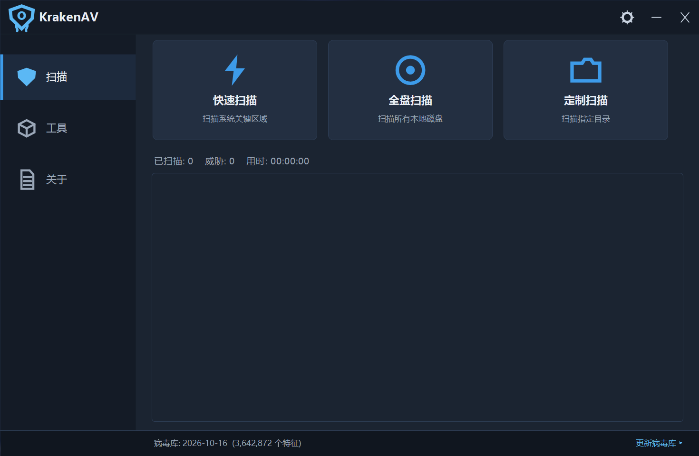
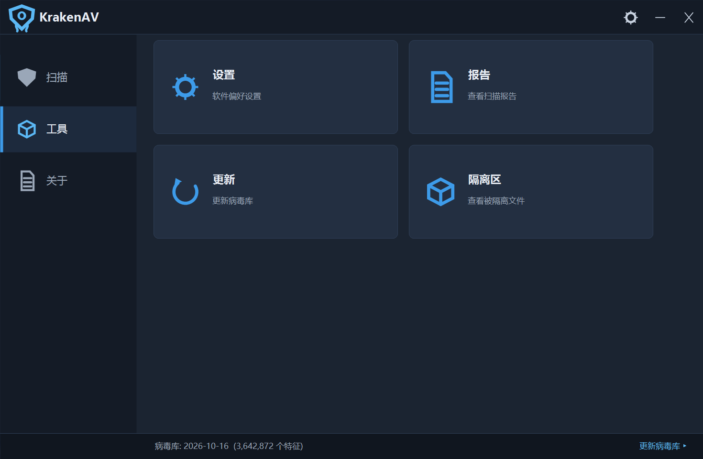
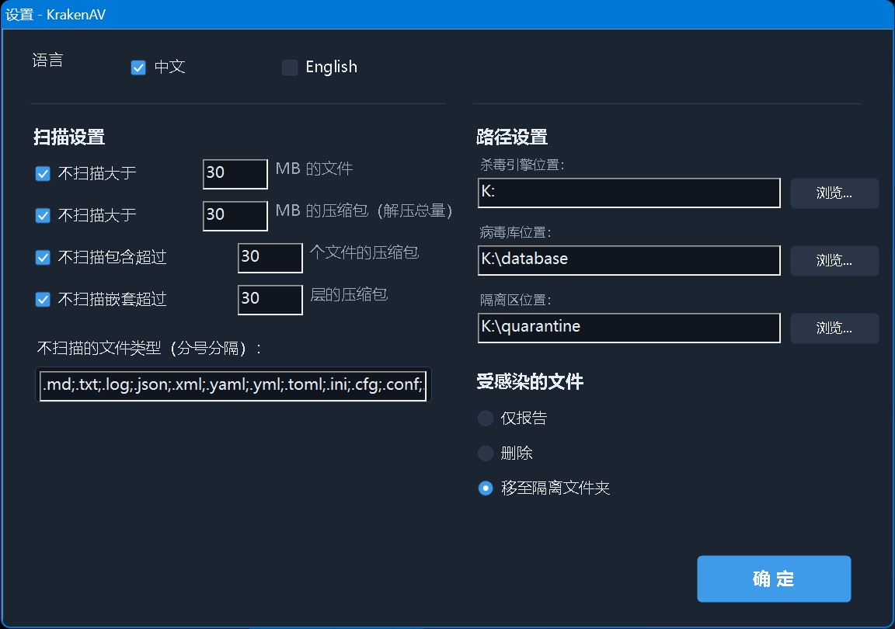
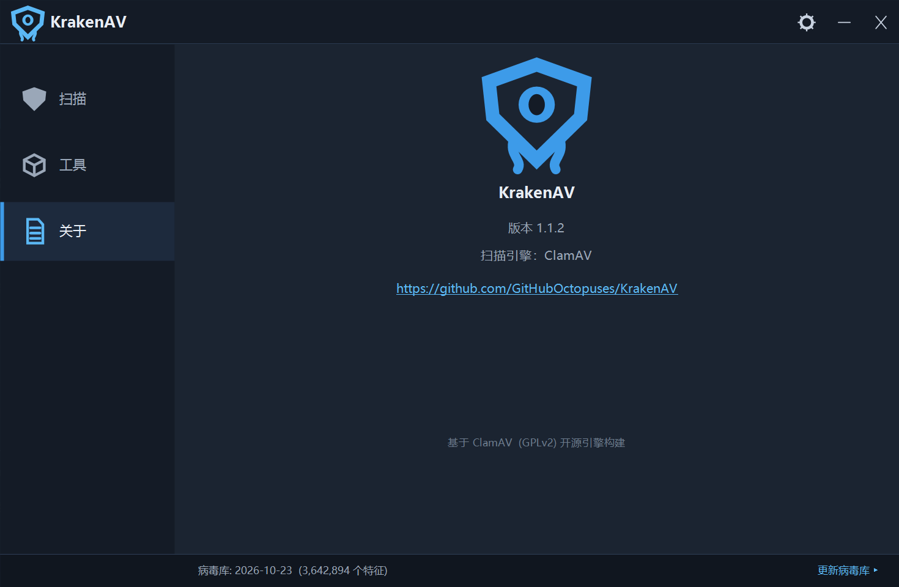

# KrakenAV 🐙

A lightweight, open-source antivirus for Windows, built on the [ClamAV](https://www.clamav.net) 1.5.4 engine with a fully hand-drawn dark-theme Win32 + GDI+ UI. No Qt, no .NET, no runtime dependencies — a single EXE next to the engine DLLs.

| Main | Tools | Settings | About |
|---|---|---|---|
|  |  |  |  |

## Highlights

- **Three scan modes** — Quick (user profile + startup folders), Full (all local drives), Custom (any folder), with live log and a stoppable scan thread
- **~3.6 million signatures** from the official ClamAV `main` + `daily` + `bytecode` databases
- **Infected-file actions**: report only / delete / move to quarantine. Delete keeps a backup copy in quarantine; quarantined files are XOR-obfuscated so renaming them back cannot re-execute the payload (restore with `quarantine_restore.exe`)
- **Flexible scan limits**: max file size, archive unpacked size, file count, nesting depth
- **Smart exclusions**: ~34 inert file types skipped by default (`.md`, `.jpg`, `.mp4`, …) — scripts and documents (`.js`, `.pdf`, `.svg`, Office) are **never** excluded
- **In-app database updates** via official `database.clamav.net`, powered by `freshclam.exe` with live progress
- **Chinese / English UI**, switchable instantly (including dialog titles)
- **Full-width Chinese path support** — see [How Chinese paths are handled](#how-chinese-paths-are-handled)
- High-DPI aware (tested at 150%), ~3.7 MB static EXE

## Download & Run

Grab the zip from [Releases](../../releases), unzip anywhere (Chinese paths are fine) and double-click `KrakenAV.exe`:

1. Click **Update DB** at the bottom-right on first run (~110 MB download)
2. Pick a scan mode. Reports land in `reports\`, quarantined (obfuscated) files in `quarantine\`; inspect `manifest.txt`, restore a file with `quarantine_restore.exe <file.quarantine> [dest]`

> If you have another antivirus (Kaspersky, 360, Huorong…), add the KrakenAV folder to its trust/exclusion list — virus databases contain millions of malicious signatures by design and will get quarantined by other engines. If that already happened, restore with the encrypted backup: `7zr.exe x -pKrakenAV2026 db_backup.7z -aoa -odatabase`.

## Building from source

Requirements: Windows 10/11, MinGW-w64 GCC (C++17), Python 3 (only to regenerate the icon).

1. Copy the `include\` folder and `clamav.lib` from the official [ClamAV Windows x64 package](https://www.clamav.net/downloads) into `src\sdk\` (a copy is already committed)
2. Place the engine DLLs + `freshclam.exe` + `certs\` next to the built EXE (or copy the whole official package layout — see the Release zip)
3. Edit `src\build.bat` and point `GCC`/`WINDRES` to your MinGW `bin\` folder
4. Run `src\build.bat [deploy-dir]` — sources are mirrored to an ASCII work directory under `%TEMP%` (MinGW `ld` cannot handle non-ASCII input paths), compiled, and deployed back
5. Self-test: `test_console.exe <install-dir>` runs 13 end-to-end checks (engine load, EICAR detection, Chinese-path scan, quarantine, delete, report)

## How Chinese paths are handled

ClamAV's official Windows build resolves certificates and databases relative to the EXE directory but opens paths through ANSI conversion, so non-ASCII directories silently fail. KrakenAV works around this at three levels, with zero user configuration:

1. **Scanned files**: `CreateFileW` handle + `cl_fmap_open_handle` with a custom `pread` callback — stock `cl_scanfile` *silently returns "clean"* for Chinese paths, which is a missed-detection hazard this project explicitly fixes
2. **Program directory**: at startup, a free drive letter (K:–Z:) is mapped onto the program directory via `DefineDosDevice` and the process transparently relaunches from the ASCII path; the mapping is removed on exit
3. **Database directory**: redirected to an ASCII path automatically

The *fundamental* fix would be patching ClamAV's Windows file-IO layer upstream (Cisco-Talos/clamav) — PRs welcome; the current approach is pure user-mode and version-independent.

## Virus database

- Source: official `database.clamav.net` (freshclam protocol)
- `database\*.cvd` files are **not** committed (large + updated daily). `db_backup.7z` in the Release is an AES-encrypted snapshot — other antivirus products cannot scan inside it, so it survives being "cleaned" by them
- `database/` in this repo only ships a README placeholder; the app creates and populates it on first update

## License

GPL-2.0 — see [LICENSE](LICENSE). ClamAV is © Cisco Talos, GPLv2.

## Acknowledgements

- [ClamAV](https://www.clamav.net) by Cisco Talos — the engine
- [MinGW-w64](https://www.mingw-w64.org) — the toolchain
- 7-Zip (`7zr.exe`) by Igor Pavlov — backup/restore utility

---

## 中文说明

基于 [ClamAV](https://www.clamav.net) 1.5.4 引擎的轻量开源 Windows 杀毒软件。界面为 Win32 + GDI+ 纯手绘深色主题，无 Qt / .NET / 运行库依赖，主体就是一个静态链接的 EXE。

**功能**：快速 / 全盘 / 定制三种扫描（实时日志、可中途停止）、约 364 万特征（官方 main + daily + bytecode 库）、染毒文件仅报告 / 删除 / 隔离（删除前自动留隔离副本；隔离文件经 XOR 混淆，改名无法直接运行，用 `quarantine_restore.exe` 恢复）、扫描大小与压缩包限制可调、默认跳过约 34 种惰性文件类型（.md .jpg .mp4 等；脚本与文档含 .svg 永不排除）、病毒库在线更新（实时进度）、中英双语界面即时切换、高 DPI 适配。

**使用**：从 [Releases](../../releases) 下载 zip，解压到任意路径（支持中文路径）双击 `KrakenAV.exe`，首次使用先点右下角"更新病毒库"（约 110 MB）。

**中文路径说明**：ClamAV 官方 Windows 版按 EXE 所在目录加载证书/病毒库，但不支持非 ASCII 路径。本程序三层解决：①被扫描文件用 `CreateFileW` 句柄 + fmap 扫描（原版 `cl_scanfile` 对中文路径会静默返回"干净"，存在漏杀风险，本程序已根治）；②程序目录含中文时自动盘符映射 + 透明重启，退出自动清理；③病毒库目录自动重定向。终极方案是向上游修正 ClamAV 的 Windows 文件 IO，欢迎 PR。

**与其他杀软共存**：病毒库（.cvd）含数百万恶意特征，会被卡巴斯基/360/火绒误删——请把本目录加入其信任/排除列表。已被误删时用加密备份恢复：`7zr.exe x -pKrakenAV2026 db_backup.7z -aoa -odatabase`。

**构建**：见上方 Building from source（MinGW-w64 + 官方包的 lib/头文件，`src\build.bat` 一键编译部署）。

**许可证**：GPL-2.0（见 [LICENSE](LICENSE)）。ClamAV © Cisco Talos。
